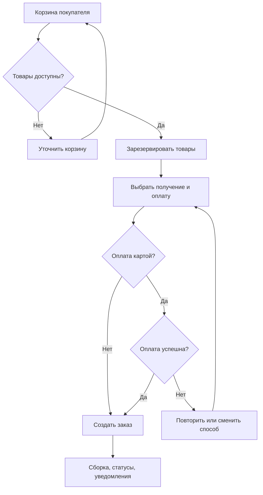

# Переделкино — анализ и модернизация процесса онлайн-заказов

**Учебный кейс по бизнес-анализу · Яндекс Практикум · 2026**

> **EN:** Business analysis case study for an online home-improvement store. I analyzed the existing order-processing flow, modeled AS-IS and TO-BE business processes, identified 18 improvement opportunities, and prepared structured requirements, use cases, acceptance criteria, a domain model, and user documentation. The solution was designed as part of training; this repository does not claim a production rollout.

## Контекст и бизнес-задача

Магазин строительных материалов и товаров для дома «Переделкино» принимает заказы через учебный интернет-магазин **PeredelkinoShop.ru**. Процесс обработки онлайн-заказа содержит много ручных операций: после оформления администратор получает письмо, связывается со складом для проверки наличия и звонит покупателю для подтверждения заказа. При невозможности дозвониться заказ задерживается, а при отсутствии товара после онлайн-оплаты требуется возврат средств.

**Цель работы:** исследовать текущий процесс, выявить препятствия для покупателей и сотрудников и спроектировать целевую модель, сокращающую ручную обработку и повышающую прозрачность оформления заказа.

## Мой вклад и артефакты

| Этап | Выполненная аналитическая работа | Результат |
| --- | --- | --- |
| **Обследование** | Анализ интервью заказчика, существующего прототипа сайта, инструкции по обработке заказов и предоставленных учебных данных | Отчёт об обследовании и **18 проблем** текущего процесса |
| **Моделирование AS-IS** | Декомпозиция работы покупателя, сайта, администратора, склада и платёжного сервиса | Диаграмма бизнес-процесса **BPMN AS-IS** |
| **Анализ клиентского пути** | Сопоставление действий покупателя, барьеров и точек роста | **CJM** и рекомендации по улучшению клиентского опыта |
| **Проектирование TO-BE** | Проработка целевого оформления, оплаты, резервирования товара, сборки, уведомлений и исключительных сценариев | Диаграмма **BPMN TO-BE** |
| **Формализация требований** | Описание пользовательских целей, сценариев и исключений | **24 user stories**, **9 use cases**, критерии приёмки для всех 24 историй |
| **Модель предметной области** | Выделение сущностей и связей интернет-магазина | UML-диаграммы классов и объектов |
| **Передача решения** | Описание пользовательских сценариев и действий при ошибках | Руководство пользователя и материалы для обучения |

Точные количественные значения относятся к подготовленным **учебным документам**, а не к внедрённой в бизнес системе.

## Редактируемые схемы процессов

- [BPMN AS-IS — исходный процесс (.drawio)](artifacts/bpmn-as-is.drawio)
- [BPMN TO-BE — целевой процесс (.drawio)](artifacts/bpmn-to-be.drawio)

Обе схемы можно открыть в [diagrams.net](https://app.diagrams.net/) и изучить роли, переходы и развилки.

## Ключевые проблемы и предлагаемые изменения

| AS-IS — выявленная проблема | TO-BE — предложенное решение |
| --- | --- |
| Наличие товара проверяется складом вручную **после** оформления заказа | Проверка актуальных остатков и **резервирование перед оплатой** |
| Администратор обрабатывает заказы через почту и телефон | Единый интерфейс сотрудников и автоматическое изменение статусов |
| Подтверждение заказа зависит от дозвона покупателю | Подтверждение в интерфейсе, уведомления и самообслуживание для типовых операций |
| Недоступность доставки при сумме заказа ниже 1 000 ₽ выясняется поздно | Проверка бизнес-правила при оформлении, предложение самовывоза |
| Покупатель не видит актуальный статус и не может изменить дату доставки | Личный кабинет, история заказов, статусы, изменение даты и отмена в разрешённых состояниях |
| Ошибки оплаты и отмена оплаченного заказа требуют сложного ручного сопровождения | Обработка ошибок оплаты, повторная попытка, отслеживаемый возврат и ручной сценарий исключения |

## Логика целевого оформления заказа

Это **сокращённая схема** для портфолио; исходные BPMN-модели содержат дополнительные роли, развилки и исключения.

## Требования и критерии приёмки

Для целевого решения оформлены сценарии работы покупателя и сотрудников, в том числе:

- поиск, фильтрация и сортировка товаров;
- актуальное наличие и ограничение количества при покупке;
- корзина, пересчёт стоимости и промокоды;
- выбор способа получения, интервала доставки и оплаты;
- корректная обработка неуспешной оплаты;
- статусы заказа, уведомления и история покупок;
- изменение доставки и отмена заказа только в допустимых статусах;
- передача заказа сотруднику и на сборку на складе.

Для **24 пользовательских историй** заданы проверяемые критерии приёмки. Примеры:

1. Если покупатель выбирает количество сверх доступного остатка, система не должна позволять оформить такую позицию.
2. Если стоимость заказа меньше **1 000 ₽**, система не предлагает доставку и показывает доступный вариант самовывоза.
3. Если онлайн-оплата не удалась, заказ не должен ошибочно получить статус «Оплачено»; пользователь может повторить попытку или изменить способ оплаты.
4. Если статус заказа запрещает отмену, система не меняет состояние заказа и объясняет причину.

## Предметная область и интеграции

В объектной модели выделены сущности **Пользователь**, **Товар**, **Категория**, **Остаток**, **Корзина**, **Заказ**, **Позиция заказа**, **Оплата**, **Промокод**, **Доставка/получение** и **Уведомление**. Определены их атрибуты, операции и связи.

Целевое решение учитывает две ключевые внешние зависимости:

- **Система складского учёта** — сведения об остатках, резервирование и снятие резерва.
- **Сервис онлайн-оплаты** — платёжная сессия, результат оплаты, чек и возврат.

В требованиях отдельно рассмотрены риски рассинхронизации остатков и статусов, отказов внешних сервисов, неуспешных возвратов и некорректных контактных данных.

## Примеры требований из выпускной работы

- [User stories и критерии приёмки](artifacts/user-stories-and-acceptance.md) — пять показательных историй из 24.
- [UC-04: оплата банковской картой](artifacts/use-case-card-payment.md) — основной и альтернативные сценарии.

## Что важно о статусе работы

- Это **учебный проект бизнес-аналитика**, а не утверждение об изменениях в действующей коммерческой системе.
- Артефакты описывают анализ, спроектированное целевое состояние и требования. Факт разработки или внедрения решения **не заявляется**.
- Исходные Word-документы и редактируемые диаграммы не размещены публично без отдельного согласования. Этот README содержит безопасное содержательное резюме работы.

**Мой профессиональный контекст:** до перехода в бизнес-анализ я работал тестировщиком ПО и фронтенд-разработчиком. Этот опыт помогает рассматривать требования одновременно со стороны пользовательского сценария, реализации и проверки качества.

**Навыки, подтверждаемые кейсом:** выявление и анализ требований, BPMN, CJM, AS-IS / TO-BE, UML, user stories, use cases, acceptance criteria, бизнес-правила, анализ интеграций, документация для пользователя.

[← Обратно к портфолио и дипломам](../../README.md)
