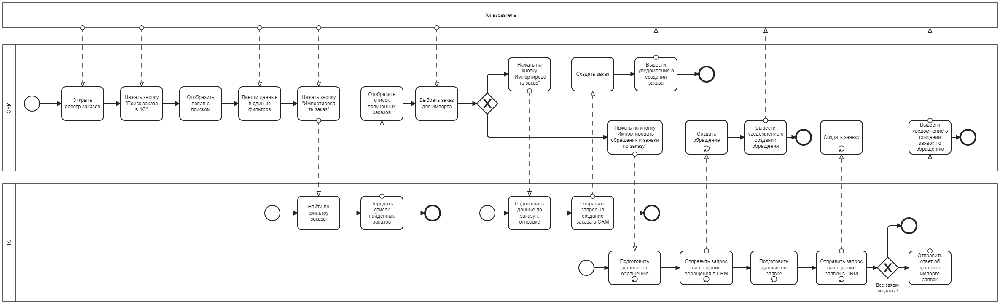

# Поиск заказа в учётной системе и импорт истории в CRM

Покупатель обращается по заказу, которого сотрудник не видит в CRM. Заказ при этом существует в учётной системе. Цель процесса — дать сотруднику возможность найти исходный заказ из своего рабочего интерфейса и выбрать, какие сведения по нему перенести.

## Кто за что отвечает

Сотрудник выбирает найденный заказ и операцию. CRM показывает форму поиска и результаты, создаёт объекты и сообщает об их создании. Учётная система ищет исходные записи и инициирует передачу выбранных данных. В BPMN 24 задачи и 2 шлюза. Документ имеет статус «Выполнено». Количественный эффект в материалах не указан.

## Как читать схему

1. **Поиск.** В реестре сотрудник указывает один из доступных признаков: номер интернет-заказа, учётный номер заказа, номер заявки на доставку или телефон. Учётная система возвращает список кандидатов.
2. **Выбор.** CRM отображает заказы с различительными признаками, включая дату, состав и сумму. Это существенно при поиске по телефону: у одного покупателя может быть несколько покупок.
3. **Импорт заказа.** По выбору сотрудника учётная система готовит данные и направляет запрос на создание заказа в CRM. Пользователь получает уведомление о созданном заказе.
4. **Импорт обращений и заявок.** Для выбранного заказа предусмотрена отдельная операция. Учётная система передаёт обращения, затем заявки по каждому обращению. Завершающее подтверждение зависит от создания всех заявок.

## Почему важны разные подтверждения

Заказ, обращение и заявка — разные объекты. Сообщение «обращение создано» достаточно для подтверждения одной записи. Если у обращения две заявки и пока создалась только одна, оно ещё не подтверждает полноту истории. При разборе сбоя сотруднику нужен результат по конкретному заказу, обращению и оставшейся заявке.

## Приёмочные примеры

| Условие | Действие | Ожидаемый результат для проверки |
|---|---|---|
| В учётной системе два заказа по одному телефону | Найти оба, выбрать более ранний по дате и составу | В CRM создаётся выбранный заказ. |
| У заказа одно обращение с двумя заявками | Выбрать импорт истории | Обе заявки относятся к правильному обращению. Итоговое подтверждение соответствует полному набору. |
| Создание второй заявки прервалось | Повторить обработку | Предлагаемое требование: дозагрузить недостающую заявку и сохранить уже созданные связи без дублей. Правило повтора требует отдельной проверки реализации. |

## Польза для сервиса

Сотрудник получает путь от поискового признака до связанной истории в одном интерфейсе. Для оценки можно сравнить время от начала поиска до открытия нужного заказа, долю обращений, обработанных без ручного переноса, и число неполных импортов. Последний показатель защищает от ложного вывода об ускорении, если CRM быстрее показывает первое уведомление, а часть заявок теряется.
