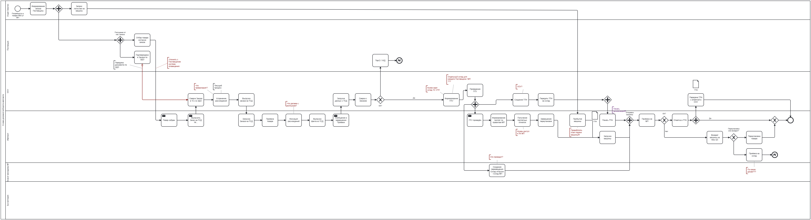

# Поставка на склад маркетплейса по модели FBO

Машина уехала со склада поставщика. Можно ли уже закрыть поставку? Для этого важно знать, сколько единиц площадка фактически приняла и какой документ подтверждает результат. Схема связывает три потока: физическое движение товара, данные терминала сбора данных (ТСД) и учётные документы. В исходной BPMN 35 задач и 10 шлюзов. Документ находился на согласовании, открытые вопросы отмечены прямо на рисунке.

## Участники и границы

Закупки формируют заказ и запрашивают транспорт. Поставщик собирает товар и подтверждает заказ через электронный документооборот (ЭДО). Сотрудники приёмки сканируют товар, готовят паллеты и загружают машину. Операторы сверяют учётные документы. Менеджер площадки участвует в оформлении перемещения. Дорожка бухгалтерии выделена отдельно, но конкретные действия на ней не заполнены — это вопрос распределения ответственности.

## Путь партии

1. **Заказ и транспорт.** После формирования заказа параллельно запускаются подготовка товара и запрос машины. Для сверки доступны заказ в учётной системе и подтверждение поставщика через ЭДО.
2. **Приёмка у поставщика.** Заказ передаётся на ТСД. Сотрудник фиксирует фактический состав и расхождения. Оператор загружает результат и сопоставляет его с заказом. Совпадение ведёт к оформлению поступления, расхождение — к разбору и корректирующим документам.
3. **Подготовка к отправке.** Паллеты формируют по требованиям площадки, получают этикетки и готовят товарно-транспортную накладную (ТТН). Документ перемещения связывает склад отправки со складом назначения.
4. **Приёмка площадкой.** На положительной ветке появляется отметка в ТТН, затем документ передают оператору. При проблеме схема предусматривает возврат машины и выбор между переупаковкой и приёмкой возвращённого товара на склад.

## Где бизнесу нужен контроль

| Контрольная точка | Свидетельство | Решение |
|---|---|---|
| Что ожидали получить? | Заказ и подтверждение поставщика | Устранить расхождение в документах до выдачи задания на ТСД. |
| Что физически поступило? | Факт сканирования и результат сверки | Оформить поступление либо передать расхождение на разбор. |
| Что приняла площадка? | Отметка приёмки и транспортные документы | Подтвердить завершение либо определить маршрут возврата. |

В модели оставлены вопросы: как учитывать излишек, кто проводит перемещение и по каким документам склад принимает вернувшийся товар. Это конкретная повестка для согласования с закупками, складом и учётом. Закрытие поставки только по факту отправки скрыло бы все три ситуации.

## Синтетический пример для приёмки

Заказаны 24 единицы, ТСД зафиксировал 23. Проверить, что оператор видит разницу в одну единицу до проведения поступления и может связать её с заказом. Во втором прогоне количество совпало, но площадка отклонила груз из-за упаковки. Проверить, что видны возврат машины и последующее решение о переупаковке. В обоих случаях у поставки есть физическое движение, но документальное основание для следующего шага различается.

## Ценность и измерение

Склад получает маршрут для непринятого груза, а учёт — точки сверки количества и документов. Для оценки предложены доля поставок, принятых площадкой с первой попытки, время от отказа до решения по партии и доля возвратов с установленной причиной. Для первого показателя повторный выезд по одной поставке нужно связать с исходной отправкой, иначе статистика скроет повторную работу. Экономический эффект требует данных пилота.
