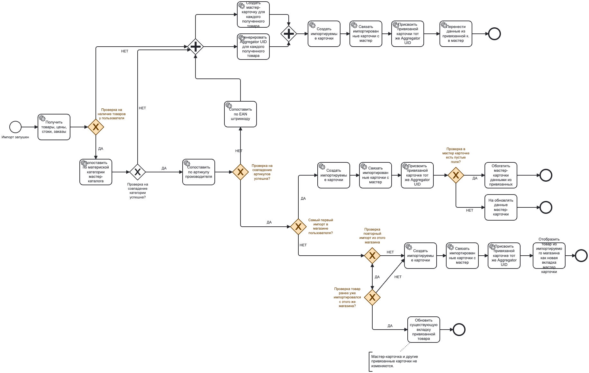

# Один товар в нескольких магазинах: сопоставление карточек при импорте

При подключении магазина агрегатор получает карточки товаров. Для каждой записи нужно решить, создавать ли новый товар, привязать ли карточку к существующему или обновить уже известные данные магазина. Ошибка в одну сторону создаёт дубликат. Ошибка в другую связывает два разных товара, после чего их характеристики трудно разделить.

## Объекты и границы

**Мастер-карточка** хранит общие сведения о товаре. **Привязанная карточка** представляет тот же товар в конкретном магазине. Общий идентификатор агрегатора (UID) связывает эти представления. На схеме 20 задач и 9 шлюзов. Разбор охватывает выбор и обновление карточек после получения данных. Исходная документация помечена как требующая актуализации.

## Три маршрута импорта

| Ситуация | Что делает система | Что проверить |
|---|---|---|
| У продавца ещё нет товаров в агрегаторе | Создаёт мастер-карточки и идентификаторы, связывает с ними импортированные карточки и переносит исходные данные. | У каждой связанной записи указан UID соответствующей мастер-карточки. |
| Товары уже есть, подключается новый источник | Сопоставляет категорию с мастер-каталогом, проверяет артикул производителя. В отдельной ветке используется штрихкод EAN. При установленной связи создаёт карточку источника. Для мастера отдельно проверяет наличие пустых полей. | Для уже известного товара появляется представление нового магазина. Проверка пустого поля и обновление заполненной характеристики требуют разных решений. |
| Из того же магазина повторно пришла известная карточка | Обновляет существующее представление магазина. В схеме явно указано, что мастер и остальные привязанные карточки сохраняются. | Повторный импорт не увеличивает число представлений товара и не меняет соседний магазин. |

## Где требуется решение владельца данных

На диаграмме есть действие сопоставления по EAN, но после него не выделено отдельное решение о нескольких кандидатах. Для автоматизации нужно определить, что делать, например, когда один штрихкод найден у двух мастер-карточек, а артикул не совпал. Предложение для такого случая — сохранить входную запись и кандидатов для ручной проверки. Успешную связь можно подтвердить после разбора.

## Пример приёмки

У учебного товара есть мастер-карточка и представления в магазинах А и Б. В карточке магазина А изменилось описание. После повторного импорта из А проверить четыре результата: UID прежний, количество привязок осталось равным двум, описание А обновилось, данные мастера и магазина Б сохранились. Проверка одного лишь количества строк пропустила бы случайную перезапись чужих данных.

## Практический эффект

Оператору каталога важно понимать, почему две карточки связались и какие поля разрешено обновлять. Для оценки качества стоит измерять отдельно долю ошибочных автоматических связей на проверенной выборке и долю дублей мастера после повторного импорта. Высокая доля автоматических совпадений сама по себе не доказывает точность. Измеренных результатов внедрения в разборе нет.
