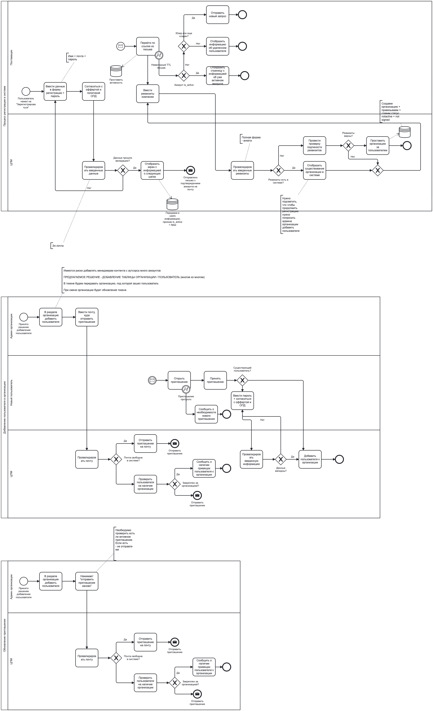

# Регистрация поставщика и доступ сотрудников к организации

Как отличить подтверждённую почту сотрудника от права действовать от имени компании? В целевой модели эти решения принимаются на разных этапах. Исходный документ описывает согласованные требования к регистрации. В BPMN 31 задача и 12 шлюзов. На рисунке сверху вниз расположены три процесса: регистрация, приглашение сотрудника и повторная отправка приглашения.

## Участники и границы

Поставщик создаёт учётную запись и указывает реквизиты. Портал проверяет поля, состояние аккаунта и наличие организации. Администратор организации инициирует приглашение. Сотрудник принимает его по почте. Граница кейса — появление связи между пользователем и организацией. Дальнейшее управление правами внутри кабинета требует отдельных требований.

## Как читать схему

1. **Регистрация.** Пользователь вводит данные и принимает условия работы. После проверки формы портал отправляет письмо. Ошибки ввода возвращают пользователя к форме.
2. **Подтверждение почты.** При переходе по ссылке портал учитывает её срок и состояние аккаунта. Для уже активного аккаунта предусмотрено сообщение. При истёкшем сроке результат зависит и от того, сохранилась ли учётная запись.
3. **Выбор организации.** Портал проверяет реквизиты. Если компания уже представлена, пользователю нужен маршрут через её администратора. При новых корректных реквизитах модель предусматривает создание организации и привязку пользователя.
4. **Приглашение сотрудника.** Администратор указывает почту. Портал различает свободный адрес и адрес существующего пользователя, проверяет действующую привязку. Новый пользователь после принятия приглашения заполняет данные, существующий проходит свою ветку.
5. **Повторная отправка.** Истёкшее приглашение требует нового запроса. В примечании к схеме выделена проверка активного приглашения перед повторной отправкой.

## Существенное решение

Адрес электронной почты идентифицирует пользователя, а реквизиты — организацию. Ни одного из этих атрибутов по отдельности недостаточно для выдачи доступа. Особенно важен случай внешнего сотрудника, работающего с несколькими компаниями. На исходной диаграмме связь «пользователь — несколько организаций» вынесена как предложение. До реализации следует решить, кто утверждает вторую привязку и как пользователь выбирает организацию для текущей работы.

## Приёмочные сценарии для портфолио

| Исходные данные | Действие | Что проверить |
|---|---|---|
| Компания уже зарегистрирована, новый сотрудник подтвердил почту | Ввести реквизиты этой компании | Второй экземпляр организации не создаётся. Сотруднику понятен следующий шаг — получить приглашение. |
| Приглашение действительно, сотрудник впервые заходит в кабинет | Принять приглашение и завершить форму | Связь появляется с организацией пригласившего администратора после проверки данных. |
| Администратор повторно запрашивает приглашение | Проверить адрес и текущее приглашение | Действующее приглашение не дублируется. Для истёкшего доступна повторная отправка. |

## Ценность и измерение

Модель помогает избежать дублей компаний и разобрать обращения вида «почту подтвердил, но компанию не вижу». Для пилота полезна воронка по событиям: отправка письма → подтверждение почты → успешное присоединение. Отдельно стоит считать обращения о доступе на 100 приглашений и дубли организаций по проверенным реквизитам. Показатели предложены для оценки внедрения; замеров в этом кейсе нет.
